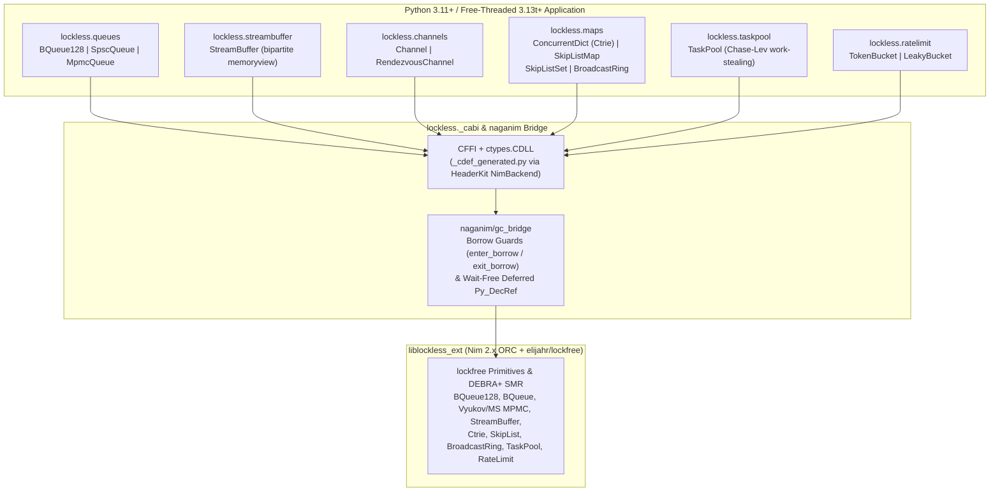

# lockless

[](#status)
[](LICENSE)
[](https://www.python.org)

> [!WARNING]
> **Experimental / Pre-Alpha Software — Not Ready for Production**
> This project is an active research and development prototype. APIs, ABI layouts, and wire formats are unstable and subject to breaking changes without notice. Do not use in production systems.

Wait-free and lock-free concurrent data structures and zero-copy DSP primitives for **Python 3.11+** (both standard CPython and Free-Threaded PEP 703 `python3.13t` / `python3.14t`), backed by [`lockfree`](https://github.com/elijahr/lockfree), [`naganim`](https://github.com/elijahr/naganim), and [`headerkit`](https://github.com/axiomantic/headerkit).

---

## Overview & Architecture

Python's `queue.Queue`, `collections.deque` locks, and `asyncio.Queue` serialize access behind mutexes or require single-threaded event-loop discipline. Under Free-Threaded Python (PEP 703 `python3.13t` / `3.14t`) or multi-threaded native DSP/worker pipelines, lock contention becomes the primary bottleneck.

`lockless` exposes native C-ABI lock-free and wait-free primitives compiled from Nim's `lockfree` library (`src/lockless_ext.nim`) with:
- **Wait-free deferred `Py_DecRef` reclamation (`naganim/gc_bridge`)**: When DEBRA+ safe memory reclamation (SMR) or ring eviction (`omDropOldest`) retires a `PyObject*` on any thread, the pointer is queued wait-free and decremented safely without lock-order inversions against the GIL.
- **Zero-copy bipartite `memoryview` DSP streaming (`StreamBuffer`)**: Direct `reserve_write` and `peek_read` access to native ring memory without intermediate `bytes` copies.
- **Zero-polling `asyncio` integration (`Channel`)**: 0-to-1 edge-triggered OS wakeup pipes (`lf_bqueue128_push_ex`) paired with a Dekker store-load fence so `async for` and `await ch.recv_async()` never poll and never miss wakeups.
- **HeaderKit `NimBackend` C-ABI codegen (`python/lockless/_codegen.py`)**: Automatically generates CFFI `CDEF` declarations and PEP 484 `.pyi` stubs from `include/lockless_ext.h` and `src/lockless_ext.nim`.



### Primitives Comparison Table

| Primitive | Module | Progress Guarantee | Topology | Memory Ordering | Blocking / Async | Key Complexity |
| :--- | :--- | :--- | :--- | :--- | :--- | :--- |
| **`BQueue128[T]`** | `lockless.queues` | Wait-Free Bounded | SPSC | Acquire / Release + 128-bit batch | Non-blocking (`push`, `pop`, `pop_batch`) | $O(1)$ amortized |
| **`SpscQueue[T]`** | `lockless.queues` | Wait-Free Bounded | SPSC | Acquire / Release (Lamport virtual ring) | Non-blocking (`push`, `pop`, `pop_batch`) | $O(1)$ |
| **`MpmcQueue[T]`** | `lockless.queues` | Lock-Free (Bounded Vyukov or Unbounded Michael-Scott) | MPMC / MPSC / SPMC | Acquire / Release + DEBRA+ SMR | Non-blocking (`push`, `pop`, `pop_batch`) | $O(1)$ |
| **`StreamBuffer`** | `lockless.streambuffer` | Wait-Free Bounded | SPSC Byte Ring | Acquire / Release | Non-blocking zero-copy `memoryview` | $O(1)$ |
| **`Channel[T]`** | `lockless.channels` | Lock-Free Fast Path + Dekker Fence | MPMC or SPSC (`spsc=True`) | SeqCst 0-to-1 wakeup fence | Sync blocking (`send`/`recv`) + `asyncio` (`send_async`/`recv_async`/`async for`) | $O(1)$ |
| **`RendezvousChannel[T]`** | `lockless.channels` | Lock-Free Exchange | MPMC 0-Capacity Handoff | Acquire / Release CAS | Sync blocking (`send`/`recv` releasing GIL) + `asyncio` | $O(1)$ |
| **`ConcurrentDict[K, V]`** (`Ctrie`) | `lockless.maps` | Lock-Free Linearizable | MPMC | Acquire / Release + Generation CAS | Non-blocking (`put`, `get`, `remove`, $O(1)$ `snapshot()`) | $O(\log_{32} N)$ |
| **`SkipListMap[K, V]`** | `lockless.maps` | Lock-Free Ordered | MPMC | Acquire / Release + DEBRA+ SMR | Non-blocking (`put`, `get`, `remove`, ordered iteration) | $O(\log N)$ |
| **`SkipListSet[T]`** | `lockless.maps` | Lock-Free Ordered | MPMC | Acquire / Release + DEBRA+ SMR | Non-blocking (`add`, `discard`, `remove`, ordered iteration) | $O(\log N)$ |
| **`BroadcastRing[T]`** | `lockless.maps` | Wait-Free (`drop_oldest`) / Lock-Free (`backpressure`) | SPMC / MPMC Pub-Sub | Acquire / Release + Hazard Box | Non-blocking (`publish`, `poll`) + timed `recv` | $O(1)$ |
| **`TaskPool`** | `lockless.taskpool` | Lock-Free Work-Stealing (Chase-Lev) | Multi-Worker Pool | SeqCst / Acquire-Release | `submit() -> Future`, `map()`, `parallel_for()`, `sync()` | $O(1)$ steal/spawn |
| **`TokenBucket`** | `lockless.ratelimit` | Lock-Free Atomic CAS | MPMC | Acquire / Release 128-bit CAS | Non-blocking `try_acquire()` + GIL-releasing `acquire(timeout)` | $O(1)$ |
| **`LeakyBucket`** | `lockless.ratelimit` | Lock-Free GCRA CAS | MPMC | Acquire / Release CAS | Non-blocking `try_acquire()` + GIL-releasing `acquire(timeout)` | $O(1)$ |

---

## Installation & Build

### Prerequisites
- **Python**: `>= 3.11` (CPython 3.11–3.14 or Free-Threaded `python3.13t` / `3.14t`)
- **Nim**: `>= 2.0.0` with `lockfree` (`>= 0.6.7`) and `naganim` (`>= 0.1.0`)

### Build Native Library & Install Package

```bash
# 1. Build the native liblockless_ext shared library (.dylib / .so / .dll)
nimble build_lib
# (or: nimble build_ext)

# 2. Install the Python package in editable mode with uv
uv pip install -e .
```

*(Note: When running from a source checkout, `lockless._cabi` will also automatically compile `src/lockless_ext.nim` on first import if `liblockless_ext` is missing or older than `src/lockless_ext.nim`).*

---

## Usage Examples by Module

### 1. Queues (`lockless.queues`: `BQueue128`, `SpscQueue`, `MpmcQueue`)

`lockless` provides wait-free SPSC queues (`BQueue128`, `SpscQueue`) and lock-free MPSC/MPMC queues (`MpmcQueue(capacity=...)` for bounded Vyukov rings and `MpmcQueue(capacity=None)` for unbounded Michael-Scott queues with DEBRA+ SMR):

```python
from lockless import BQueue128, MpmcQueue, SpscQueue

# 1. BQueue128: Wait-free 128-bit batched SPSC ring buffer (capacity power of 2 in [128, 16384])
with BQueue128[int](capacity=256) as bq:
    was_empty = bq.push_ex(10)  # True on 0 -> 1 transition
    bq.push(20)
    assert bq.pop() == 10
    assert bq.pop_batch(max_count=16) == [20]

# 2. SpscQueue: Wait-free Lamport SPSC ring buffer (capacity power of 2 in [2, 65536])
with SpscQueue[str](capacity=64) as spsc:
    spsc.push("alpha")
    spsc.push("beta")
    assert spsc.pop() == "alpha"
    assert spsc.try_pop() == "beta"
    assert spsc.try_pop(default=None) is None

# 3. MpmcQueue (bounded MPSC / MPMC): Vyukov ring with dedicated producer/consumer handles
with MpmcQueue[dict[str, int]](capacity=1024) as mpmc:
    with mpmc.producer() as prod, mpmc.consumer() as cons:
        prod.push({"seq": 1})
        prod.push({"seq": 2})
        assert cons.pop_batch(max_count=10) == [{"seq": 1}, {"seq": 2}]

# 4. Unbounded MpmcQueue (capacity=None): Lock-free Michael-Scott queue with DEBRA+ SMR
with MpmcQueue[int](capacity=None) as unbounded_q:
    for i in range(1000):
        unbounded_q.push(i)
    assert len(unbounded_q) == 1000
    assert unbounded_q.pop() == 0
```

### 2. Zero-Copy DSP Byte Stream Ring (`lockless.streambuffer`: `StreamBuffer`)

`StreamBuffer` provides two-phase zero-copy `reserve_write` and `peek_read` context managers that yield bipartite `(first_view, second_view)` `memoryview` pairs (handling ring wrap-around without copying):

```python
from lockless import StreamBuffer

with StreamBuffer(capacity=4096) as sb:
    payload = b"zero-copy-audio-frame"

    # Zero-copy two-phase write reservation (automatically commits on clean exit)
    with sb.reserve_write(len(payload)) as (v1, v2):
        n1 = min(len(v1), len(payload))
        v1[:n1] = payload[:n1]
        if n1 < len(payload):
            v2[: len(payload) - n1] = payload[n1:]

    # Zero-copy two-phase read peek (read-only memoryview pair)
    with sb.peek_read() as (r1, r2):
        reconstructed = bytes(r1) + bytes(r2)
        assert reconstructed == payload
    sb.consume_read(len(payload))
    assert sb.is_empty
```

### 3. Sync & Async Channels (`lockless.channels`: `Channel`, `RendezvousChannel`)

`Channel` supports both synchronous thread blocking (`send` / `recv`) and zero-polling `asyncio` (`send_async` / `recv_async` / `async for`) using a 0-to-1 edge-triggered OS wakeup pipe and Dekker fence. `RendezvousChannel` provides zero-capacity synchronous and async handoffs:

```python
import asyncio
import threading
from lockless import Channel, RendezvousChannel

async def channel_example() -> None:
    # Bounded SPSC or MPMC channel with zero-polling asyncio wakeup
    with Channel[int](capacity=128, spsc=True) as ch:
        await ch.send_async(1)
        await ch.send_async(2)
        ch.close()

        items = [x async for x in ch]
        assert items == [1, 2]

    # Zero-capacity RendezvousChannel handoff across threads / coroutines
    with RendezvousChannel[str]() as rv:
        def sender_thread() -> None:
            corr_id = rv.send("direct-handoff", timeout=2.0)
            assert corr_id > 0

        t = threading.Thread(target=sender_thread)
        t.start()
        msg = await rv.recv_async(timeout=2.0)
        t.join()
        assert msg == "direct-handoff"

asyncio.run(channel_example())
```

### 4. Associative Maps & Pub/Sub Broadcast (`lockless.maps`: `ConcurrentDict`, `SkipListMap`, `SkipListSet`, `BroadcastRing`)

```python
from lockless import BroadcastRing, ConcurrentDict, SkipListMap, SkipListSet

# 1. ConcurrentDict (Ctrie) with O(1) linearizable snapshot()
with ConcurrentDict[str, int]({"a": 1, "b": 2}) as cmap:
    cmap.put_if_absent("c", 3)
    with cmap.snapshot() as snap:
        cmap["a"] = 99  # Mutating live map does not affect O(1) snapshot
        assert snap["a"] == 1
        assert cmap["a"] == 99

# 2. SkipListMap & SkipListSet: Lock-free sorted containers (supports int, float, str, bytes, tuples)
with SkipListMap[tuple[int, str], str]() as slm:
    slm[(20, "b")] = "second"
    slm[(10, "a")] = "first"
    assert slm.keys() == [(10, "a"), (20, "b")]

with SkipListSet[int]([30, 10, 20]) as sls:
    sls.add(15)
    assert sls.to_list() == [10, 15, 20, 30]

# 3. BroadcastRing: Multi-subscriber pub/sub ring buffer
with BroadcastRing[str](capacity=64, overflow="drop_oldest", max_readers=8) as ring:
    with ring.subscribe() as sub1, ring.subscribe() as sub2:
        ring.publish("event-1")
        assert sub1.poll() == "event-1"
        assert sub2.poll() == "event-1"
```

### 5. Work-Stealing Thread Pool (`lockless.taskpool`: `TaskPool`)

```python
from lockless import TaskPool

with TaskPool(num_workers=4) as pool:
    # Submit single callable returning a concurrent.futures.Future
    fut = pool.submit(lambda x, y: x + y, 19, 23)
    assert fut.result() == 42

    # Parallel map across workers
    squares = pool.map(lambda x: x * x, range(8))
    assert squares == [0, 1, 4, 9, 16, 25, 36, 49]

    # Parallel chunked range execution: fn(chunk_start, chunk_stop) or fn(i)
    buckets: list[tuple[int, int]] = []
    pool.parallel_for(0, 100, lambda start, stop: buckets.append((start, stop)), chunk_size=25)
```

### 6. Lock-Free Rate Limiters (`lockless.ratelimit`: `TokenBucket`, `LeakyBucket`)

```python
from lockless import LeakyBucket, TokenBucket

# TokenBucket: 128-bit CAS token bucket (burst capacity + steady-state refill_rate/sec)
with TokenBucket(capacity=10, refill_rate=100) as tb:
    assert tb.try_acquire(5) is True
    assert tb.acquire(2, timeout=0.1) is True

# LeakyBucket: GCRA leaky bucket rate meter (capacity + leak_rate/sec)
with LeakyBucket(capacity=10, leak_rate=100) as lb:
    assert lb.try_acquire(1) is True
    assert lb.acquire(1, timeout=0.1) is True
```

---

## Documentation

- [**Overview & Quickstart (`docs/index.md`)**](docs/index.md)
- [**Comprehensive Primitives Guide & API Reference (`docs/primitives.md`)**](docs/primitives.md)
- [**Architecture & C-ABI Bridge Deep Dive (`docs/architecture.md`)**](docs/architecture.md)

---

## Testing & Verification

```bash
# Run the full pytest suite
uv run pytest

# Run Ruff linter
uv run ruff check .

# Run strict Mypy type checking
uv run mypy python
```

---

## License

MIT License — see [LICENSE](LICENSE) for details.
