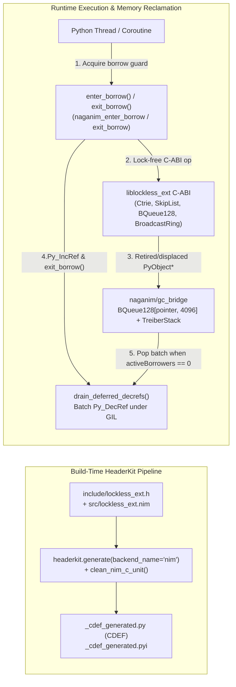

# `lockless` Architecture & C-ABI Bridge Deep Dive

> [!WARNING]
> **Experimental / Pre-Alpha Software — Not Ready for Production**
> This project is an active research and development prototype. APIs, ABI layouts, and wire formats are unstable and subject to breaking changes without notice. Do not use in production systems.

`lockless` combines three components to deliver native wait-free and lock-free concurrency in Python without sacrificing CPython reference-counting safety or static type checking:

1. **[`elijahr/lockfree`](https://github.com/elijahr/lockfree)**: Pure-Nim wait-free/lock-free algorithms, 128-bit CAS primitives, and DEBRA+ / hazard-pointer safe memory reclamation (SMR).
2. **[`elijahr/naganim`](https://github.com/elijahr/naganim)**: Runtime lifecycle (`naganim_init_runtime`), cross-thread reader borrow guards (`naganim_enter_borrow` / `naganim_exit_borrow`), and wait-free deferred `Py_DecRef` retirement queues (`naganim/gc_bridge`).
3. **[`axiomantic/headerkit`](https://github.com/axiomantic/headerkit)**: First-class `NimBackend` C-ABI header parsing (`backend_name="nim"`, `clean_nim_c_unit`) generating `python/lockless/_cdef_generated.py` and `python/lockless/_cdef_generated.pyi`.

---

## End-to-End Architecture



---

## 1. Safe `PyObject*` Reference Accounting Across Lock-Free Containers

Storing Python objects inside lock-free C/Nim containers introduces two classic memory-safety hazards:
1. **GC / SMR Destruction on Non-Python Threads**: When an item is overwritten in `BroadcastRing` (`drop_oldest`), replaced/deleted in `ConcurrentDict` or `SkipListMap`, or reclaimed by DEBRA+ epoch advancement on a worker thread, calling `Py_DecRef` without holding the GIL corrupts CPython's allocator, while calling `PyGILState_Ensure()` inside an SMR callback risks AB-BA deadlocks.
2. **Use-After-Free (UAF) Between Container Lookup and `Py_IncRef`**: A reader thread that looks up a `PyObject*` in a `ConcurrentDict` or `SkipListMap` receives a borrowed pointer. If a concurrent writer removes that key and immediately triggers `Py_DecRef` before the reader increments the Python refcount, the object can be freed in flight.

### How `lockless` + `naganim` Solve Both Hazards
- **Boxing (`box_pyobj`)**: Increments the Python reference count (`_Py_IncRef`) before passing the `void*` pointer into the C-ABI container. `None` is mapped to a dedicated `_NONE_SENTINEL` object so `NULL` (`0x0`) remains unambiguously reserved for empty C-ABI slots.
- **Wait-Free Retirement (`ll_retire_pyobj` $\to$ `naganim_retire_pyobj`)**: Whenever a container evicts, replaces, removes, or destroys an entry, the C-ABI layer enqueues the `PyObject*` into `naganim/gc_bridge`'s wait-free `BQueue128` + `TreiberStack` retirement queue without touching the GIL.
- **Cross-Thread Borrow Guards (`enter_borrow` / `exit_borrow`)**: Before any non-consuming lookup (`ConcurrentDict.get`, `SkipListMap.get`, `Subscriber.poll`), the reader increments both a thread-local borrow depth counter and the global atomic `naganim_enter_borrow()` counter. It then unboxes the returned `PyObject*` (which increments its Python refcount via `ctypes.py_object`) and calls `exit_borrow()`.
- **Batch Deferred Drain (`drain_deferred_decrefs`)**: `drain_deferred_decrefs()` pops retired `PyObject*` pointers in batches of 256 (`ll_pop_deferred_decref_batch`) and calls `Py_DecRef` **only when `activeBorrowers == 0`**, guaranteeing that no in-flight reader can ever observe a freed `PyObject*`.

---

## 2. Zero-Pickle Lexicographical Key Encoding (`encode_key`)

`ConcurrentDict`, `SkipListMap`, and `SkipListSet` never invoke `pickle`. Instead, `python/lockless/_cabi.py` (`encode_key`) encodes Python keys into a deterministic C-ABI representation `(kind, int_val, float_val, bytes_val)`:
- **64-bit Signed Integers & Booleans (`kind = 0`)**: Passed directly in the 64-bit `int_val` register with zero heap allocations.
- **Arbitrary-Precision Big Integers (`kind = 0` with `bytes_val`)**: Encoded into order-preserving big-endian magnitude bytes (with inverted length and two's-complement byte inversion for negative bigints) so arbitrary-size integers sort identically to Python's `<` operator.
- **IEEE-754 Floats (`kind = 1`)**: Handled in `src/lockless_ext.nim` with full `NaN`, `-Inf`, `+Inf`, `-0.0 == +0.0`, and exact cross-type `int == float` (`1 == 1.0`) equivalence.
- **UTF-8 Strings (`kind = 2`) & Bytes (`kind = 3`)**: Passed as zero-copy CFFI buffer slices.
- **Nested Scalar Tuples (`kind = 4`)**: Recursively encoded with type-tag prefixes and escaped null terminators (`\x00` $\to$ `\x00\xff`) so lexicographical byte comparison matches tuple comparison element-by-element.

---

## 3. Zero-Polling `Channel` Wakeup & Dekker Store-Load Fence

`Channel` (`python/lockless/channels.py`) bridges synchronous threads and `asyncio` coroutines over a single lock-free queue:
1. **Uncontended Fast Path**: When `waiting_readers == 0` and no `asyncio` loops have registered waiters, `send_nowait` / `recv_nowait` execute purely lock-free C-ABI `push_ex` / `pop` calls without acquiring any Python `threading.Lock` or touching the OS pipe.
2. **0-to-1 Edge-Triggered Pipe Notification**: `push_ex` returns `was_empty = True` when the underlying `BQueue128` or `MpmcQueue` transitions from `0` to `1` item. When async readers are waiting, the producer writes a single byte (`\x01`) to the non-blocking OS wakeup pipe monitored by `loop.add_reader`.
3. **Dekker Store-Load Fence**: Before a consumer parks on a `Condition` or `await fut`, it increments `_waiting_readers` (and appends `fut` to `_async_read_waiters`) and **re-polls `self._queue.pop()`**. This store-load fence guarantees that a concurrent producer either sees `_waiting_readers > 0` and signals the wakeup pipe/condition, or the consumer immediately pops the newly pushed item without parking.

---

## 4. HeaderKit `NimBackend` Codegen (`python/lockless/_codegen.py`)

`python/lockless/_codegen.py` uses `headerkit.generate(..., writer_name="json", backend_name="nim")` and `clean_nim_c_unit()` to parse `include/lockless_ext.h` alongside `src/lockless_ext.nim` and emit:
- `python/lockless/_cdef_generated.py`: The `CDEF` string passed to `ffi.cdef(CDEF)` in `lockless._cabi`.
- `python/lockless/_cdef_generated.pyi`: PEP 484 type stubs for the generated C-ABI module.

To regenerate the bindings after modifying `include/lockless_ext.h` or `src/lockless_ext.nim`:

```bash
uv run python -m lockless._codegen
```
